# Library Management System

## A. Project Introduction

The **Library Management System** is a console-based application developed in the C programming language for managing library operations in an educational institution. It provides separate Admin and Student portals and supports book and student records, book issuing and returning, room and computer-lab slot booking, fines, complaints and suggestions, student requests, reports, workflow summaries, and activity tracking. The project demonstrates the use of structures, arrays, functions, pointers, conditional statements, loops, string handling, and file handling in C. Records are saved in a binary data file so that information can be loaded again when the program is restarted.

## B. Features & Test Cases (Execution Scenarios)

> **Screenshot note:** Put the actual terminal screenshots in the `screenshots` folder. Keep the filenames below unchanged, or update the image paths in this README if you use different names. Capture the program output after performing each test; do not use screenshots of source code as execution evidence.

### Case 1: Main Menu and Admin Login

- **Description:** Checks the main portal selection and verifies that the administrator can log in with valid credentials. The program also limits incorrect login attempts.
- **Inputs:** Select `1`; username `admin`; password `1234`.
- **Expected Output:** Admin login succeeds and the Admin Panel is displayed. Incorrect credentials display an error and remaining attempts.
- **Screenshot:**

  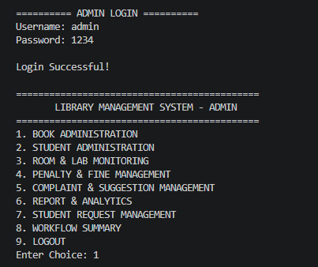

### Case 2: Student Registration and Login

- **Description:** Tests new student registration, password confirmation, student ID generation, and student login.
- **Inputs:** Select Student Portal, then registration. Example: name `Ahmed Khan`, department `Computer Science`, semester `2`, contact `03001234567`, password `ahmed123`, and matching confirmation. Then log in using the generated ID and password.
- **Expected Output:** Registration succeeds, a student ID is displayed, and valid login opens the Student Dashboard and Student Portal.
- **Screenshot:**

  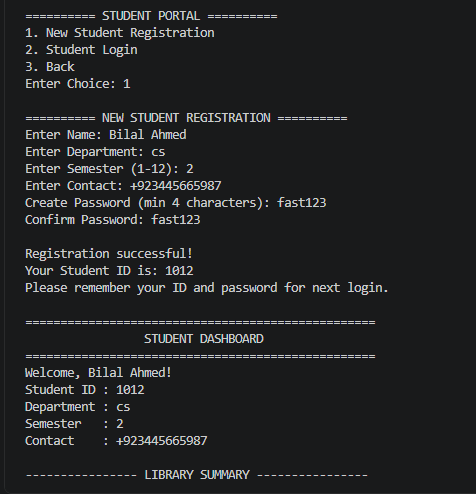

### Case 3: Book Administration

- **Description:** Tests adding, displaying, searching, updating, and removing book records.
- **Inputs:** Admin Panel → Book Administration. Example new book: ID `50`, title `C Basics`, author `John Smith`, category `Computer`, copies `5`. Search and update using ID `50`.
- **Expected Output:** The book is added and displayed with its details and available copies. Search and update show the correct record. A book that has issued copies cannot be removed.
- **Screenshot:**

  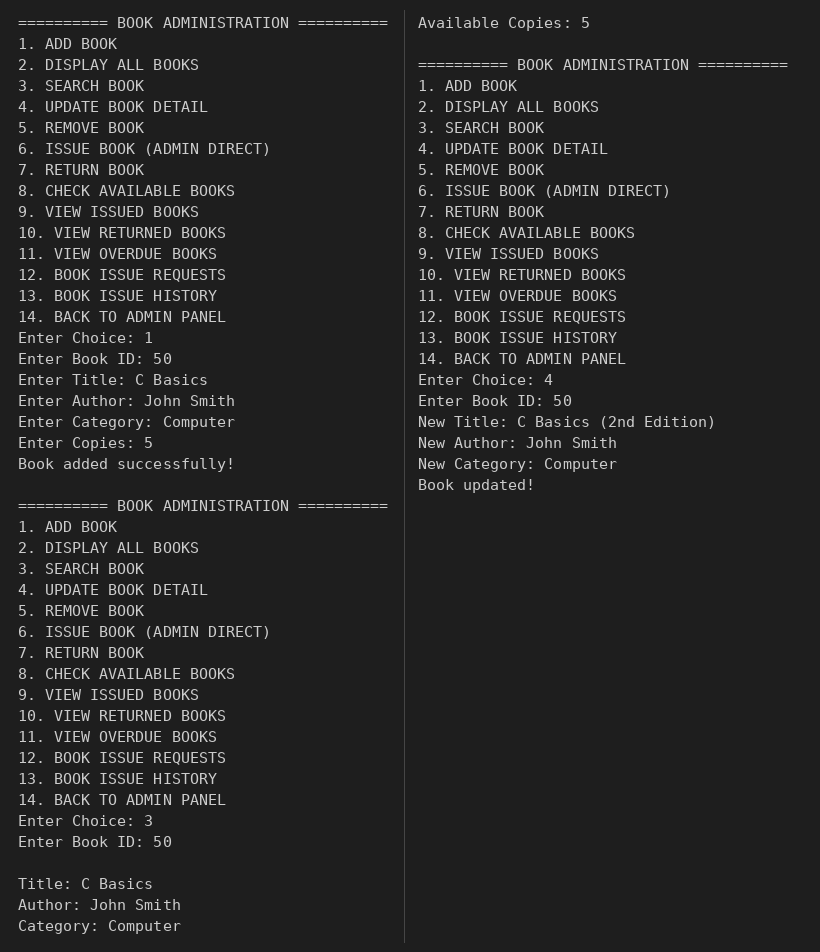

### Case 4: Book Issue and Return

- **Description:** Tests issuing an available book to a registered student and returning that book.
- **Inputs:** Admin Panel → Book Administration → Issue Book. Example: student ID `1001`, book ID `1`, issue date `10-11-2026`, due date `17-11-2026`. For return, enter the same student and book IDs and a return date such as `15-11-2026`.
- **Expected Output:** The book is issued successfully and its available-copy count decreases. On return, the transaction is marked as returned and the available-copy count increases. A late return creates a fine at Rs. 10 per late day.
- **Screenshot:**

  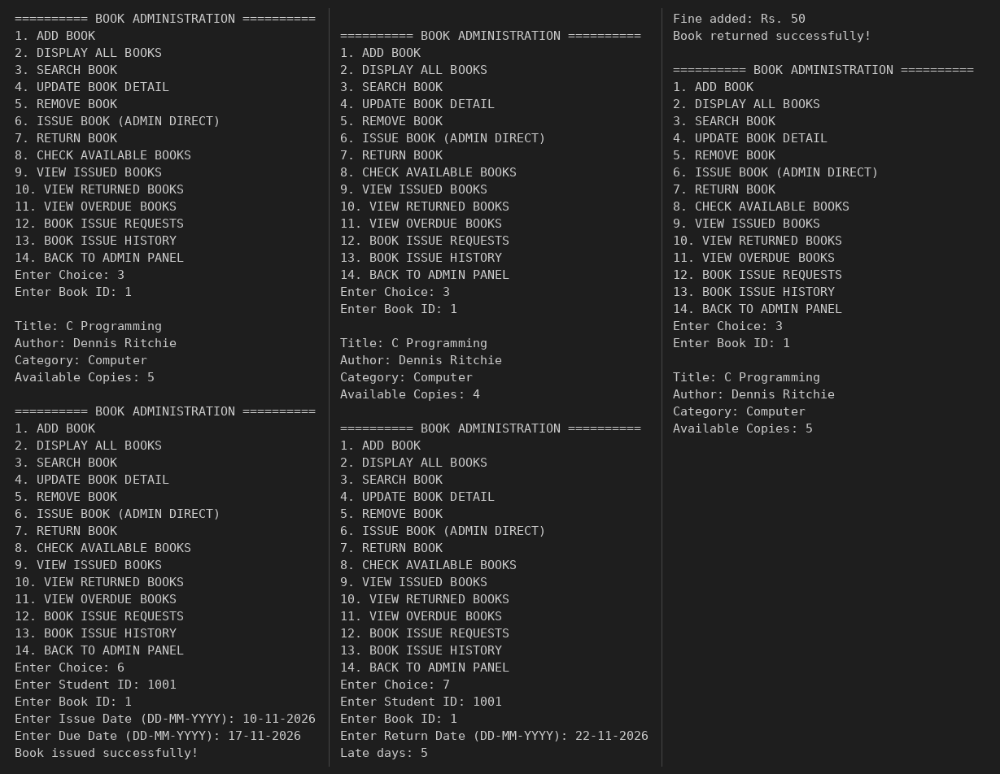

### Case 5: Available Books and Transaction Records

- **Description:** Checks available-book listing and the issue history, currently issued books, returned books, and overdue-book records.
- **Inputs:** Admin Panel → Book Administration. Use the available-books and transaction-history menu options. Enter a valid current date when checking overdue books.
- **Expected Output:** The program displays the matching books and transaction records, or a message when no matching records exist.
- **Screenshot:**

  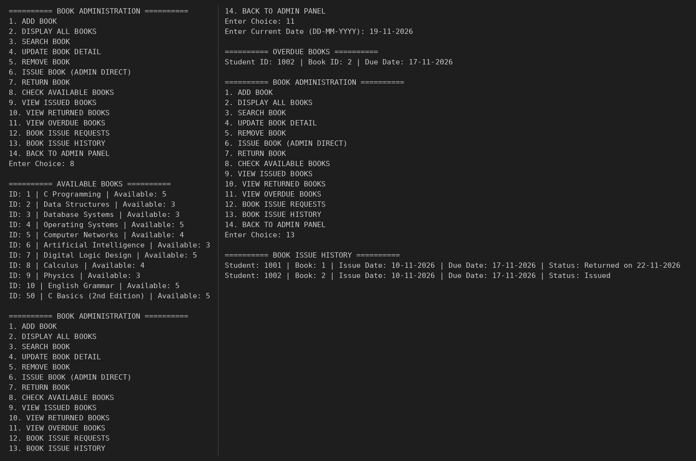

### Case 6: Student Records Management

- **Description:** Tests adding, displaying, searching, updating, and removing student records, as well as viewing a student's borrowing history.
- **Inputs:** Admin Panel → Student Administration. Example: student ID `1100`, name `Sara Ali`, department `Software Engineering`, semester `3`, contact `03001234567`, password `sara123`.
- **Expected Output:** Student details are saved and displayed correctly. Search and update work for an existing student. A student with an active issued book cannot be removed until the book is returned.
- **Screenshot:**

  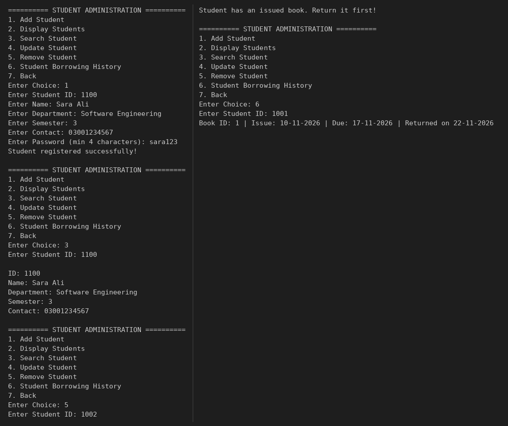

### Case 7: Room and Computer-Lab Management

- **Description:** Tests adding rooms/labs, viewing their time slots, booking a free slot, and releasing a booked slot.
- **Inputs:** Admin Panel → Room & Lab Monitoring. Example: room ID `301`, name `Computer Lab A`, capacity `30`, type `2` for Computer Lab. Select a displayed slot such as `09:00 - 10:00`.
- **Expected Output:** The room/lab is added. Free and booked slots are displayed. A free slot can be booked, and a booked slot can be released. The program prevents booking an already-booked slot.
- **Screenshot:**

  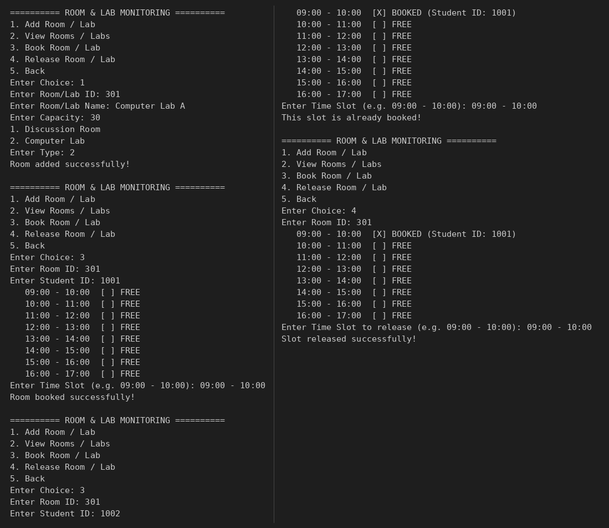

### Case 8: Student Book and Room Requests

- **Description:** Tests submitting book-issue and room/lab-booking requests from the Student Portal and checking their status.
- **Inputs:** Log in as a student. Request an available book by its ID. For a room request, select a room ID and a free time slot. Open View My Request Status.
- **Expected Output:** A request ID is generated and its status is shown as Pending until an administrator processes it. Duplicate pending room-slot requests are prevented.
- **Screenshot:**

  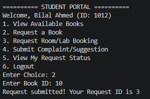
  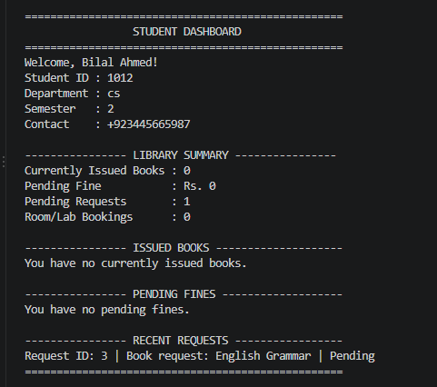

### Case 9: Admin Request Approval and Rejection

- **Description:** Tests viewing all or pending student requests and approving or rejecting a request.
- **Inputs:** Admin Panel → Student Request Management. Enter an existing pending request ID and choose `1` to approve or `2` to reject. For a book request approval, enter valid issue and due dates when prompted.
- **Expected Output:** The request status changes to Approved or Rejected. An approved book request creates an issue transaction; an approved room request books its selected slot.
- **Screenshot:**

  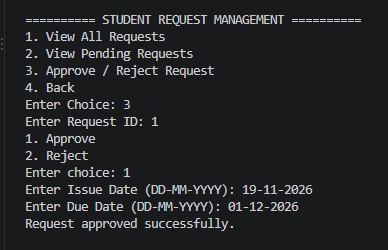
   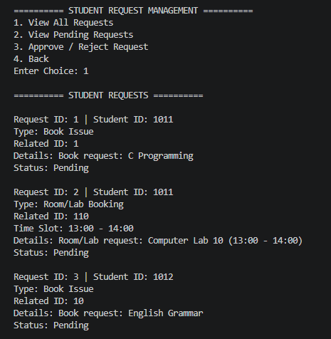

### Case 10: Fine Management

- **Description:** Tests adding a fine, viewing fine records, and recording payment of pending fines.
- **Inputs:** Admin Panel → Penalty & Fine Management. Example: student ID `1001`, amount `100`, reason `Late return`.
- **Expected Output:** The fine is added with Pending status. After payment, the fine status is displayed as Paid.
- **Screenshot:**

  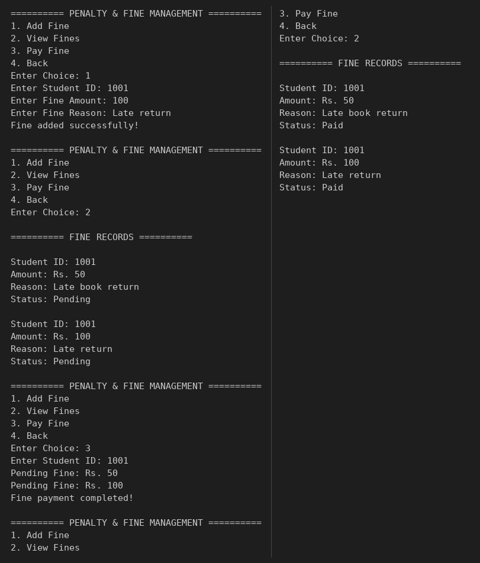

### Case 11: Complaint and Suggestion Management

- **Description:** Tests student complaint/suggestion submission and the administrator's ability to accept or reject it.
- **Inputs:** Log in as a student and submit a message such as `Please add more programming books.` Then, as admin, open Complaint & Suggestion Management and process the complaint ID.
- **Expected Output:** The complaint is saved with Pending status. The administrator can accept it or reject it with a reason. The updated status is visible to the student.
- **Screenshot:**

  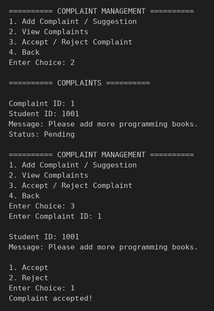
   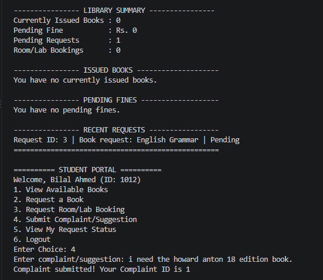

### Case 12: Reports and Analytics

- **Description:** Tests the administrative reports for book issues, student records, fine collection, and the most borrowed book.
- **Inputs:** Admin Panel → Report & Analytics. Select each report option after creating relevant sample records.
- **Expected Output:** The system displays transaction counts, student records, total/collected/pending fines, and the most borrowed book when borrowing records exist.
- **Screenshot:**

  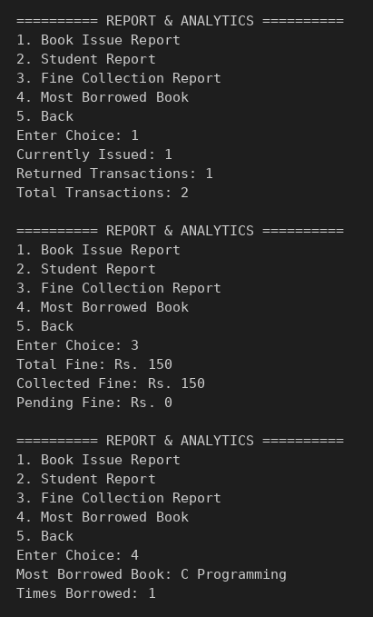

### Case 13: Workflow Summary and Recent Activity

- **Description:** Tests the overall workflow summary, completed work, current work, pending work, and recent activity log.
- **Inputs:** Admin Panel → Workflow Summary. Enter a valid date in `DD-MM-YYYY` format and open the summary options.
- **Expected Output:** The system separates completed, in-progress, and pending work; displays overdue information when a date is entered; and lists recent recorded activities.
- **Screenshot:**

  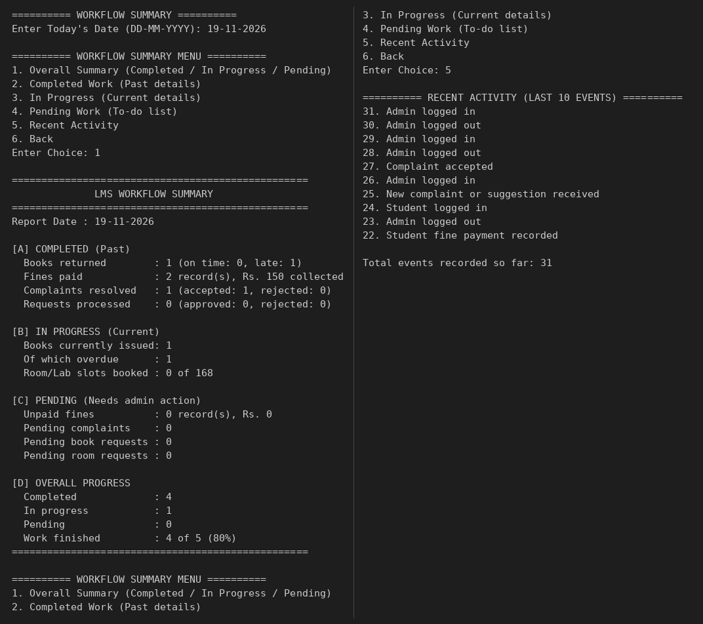

### Case 14: Input Validation and Error Handling

- **Description:** Checks how the program handles invalid menu choices, non-numeric menu input, invalid dates, invalid time slots, incorrect login details, and unavailable records.
- **Inputs:** Enter a letter at a numeric menu prompt, an invalid date such as `31-02-2026`, an invalid time slot, an incorrect ID, or incorrect login credentials.
- **Expected Output:** The program displays a suitable error message, rejects invalid data, and asks for valid input again where supported. Date and time-slot input allow a limited number of attempts.
- **Screenshot:**

  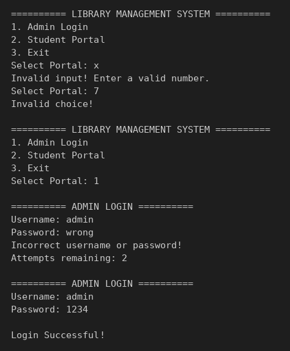

  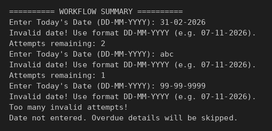
    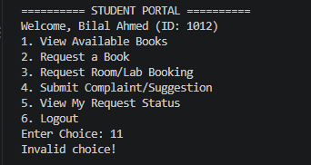
### Case 15: File Handling and Data Persistence

- **Description:** Tests whether the system saves records to a file and loads them after the program is closed and started again.
- **Inputs:** Add a book or student, or create a request. Exit the program normally and run it again.
- **Expected Output:** Previously saved records remain available after restarting. The program uses `library_requests.dat` for stored application data and `activity.txt` for activity logging.
- **Screenshot:**

  Project folder showing the saved data file `library_requests.dat` and the activity log `activity.txt`:

  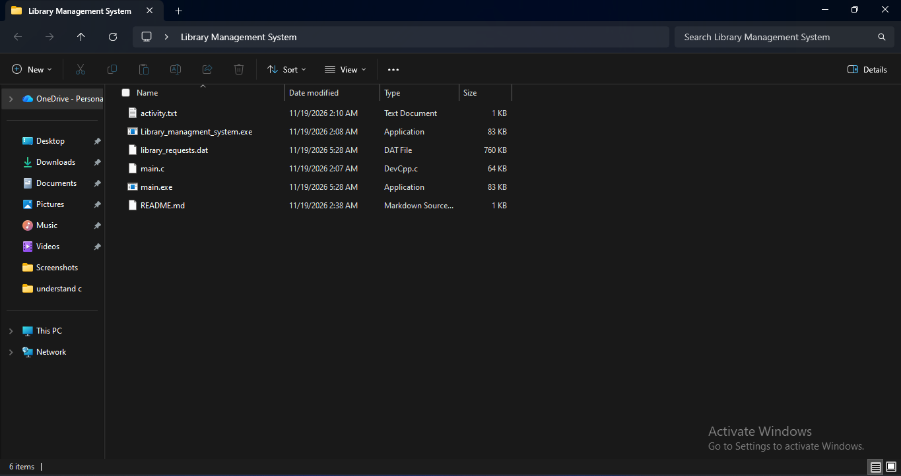

  Contents of `activity.txt` showing the recorded activity (student registered, requests received, student logged in):

  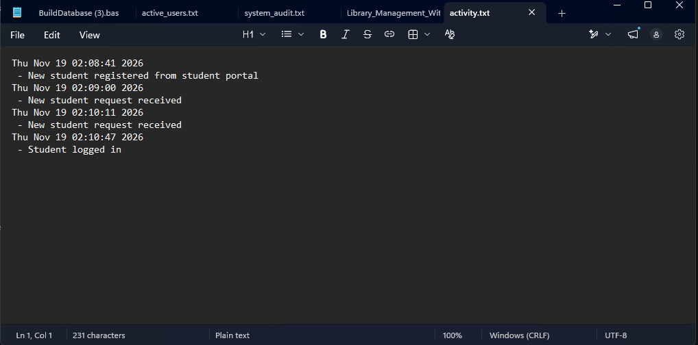

## C. Instructions to Clone and Execute

### Step 1: Clone the Repository

Open a terminal and run the following command. Replace `YOUR_GITHUB_USERNAME` with your GitHub username if you use a different repository owner.

```bash
git clone https://github.com/YOUR_GITHUB_USERNAME/library_management_system.git
cd library_management_system
```

### Step 2: Compile the Code

Make sure GCC is installed.

**Windows (MinGW / GCC):**

```bash
gcc main.c -o library_management.exe
```

**Linux:**

```bash
gcc main.c -o library_management
```

### Step 3: Run the Program

**Windows (Command Prompt):**

```cmd
library_management.exe
```

**Windows (PowerShell):**

```powershell
.\library_management.exe
```

**Linux:**

```bash
./library_management
```

The program creates or updates its data files in the working directory. Keep `library_requests.dat` and `activity.txt` in the project folder when you want to retain the saved records and activity log.


